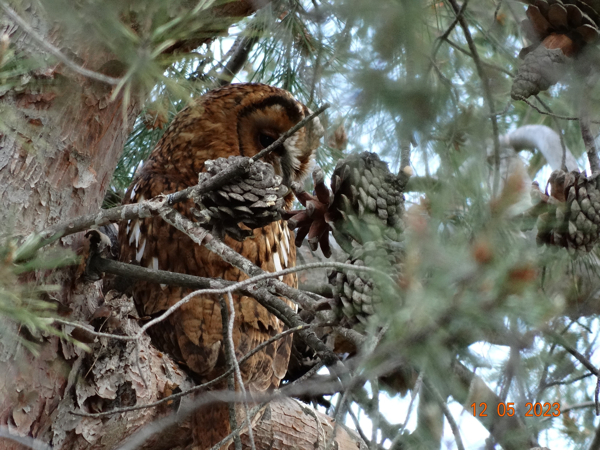

```{=html}
<section class="outreach-hero" aria-labelledby="outreach-title">
  <div class="outreach-hero-inner section-width">
    <span class="eyebrow"><span class="dot"></span> SCIENCE COMMUNICATION · PUBLIC ENGAGEMENT</span>
    <h1 id="outreach-title">Curiosity is contagious.<br><em>Science is meant to be shared.</em></h1>
    <p>Nature has fascinated me for as long as I can remember. Here are some of the stories, conversations and public events through which I have been fortunate enough to share that fascination with others.</p>
    <div class="outreach-jump-links" aria-label="Explore outreach activities">
      <a href="#outreach-wildlife">Wildlife &amp; live cameras ↓</a>
      <a href="#outreach-audio">Podcasts &amp; television ↓</a>
      <a href="#outreach-press">Research in the media ↓</a>
      <a href="#outreach-famelab">FameLab Spain 2020 ↓</a>
      <a href="#outreach-events">Outreach &amp; public events ↓</a>
    </div>
  </div>
</section>

<section id="outreach-wildlife" class="home-section section-width outreach-section" aria-labelledby="outreach-wildlife-heading">
  <div class="section-heading">
    <div><span class="eyebrow">NATURE STORIES</span><h2 id="outreach-wildlife-heading">A window into the wild</h2></div>
    <p>Watching a wild animal up close can spark a lasting fascination with the living world.</p>
  </div>
  <article class="outreach-story">
    <a class="outreach-story-image" href="posts/Carabo.html" aria-label="Read the story of the tawny owls"></a>
    <div class="outreach-story-copy">
      <span class="outreach-kicker">TAWNY OWLS · SEO/BIRDLIFE · 2024–2025</span>
      <h3>The tawny owls in my garden</h3>
      <p>A homemade nest box became a window into the private lives of a tawny owl family. In 2024–2025, I supported SEO/BirdLife with footage and resources for a 24-hour live broadcast from the nest box in Toledo.</p>
      <div class="outreach-action-row">
        <a class="text-link" href="posts/Carabo.html">Read the story <span aria-hidden="true">→</span></a>
        <a class="text-link" href="https://www.youtube.com/watch?v=wj99mz2KuK0&amp;t=34s" target="_blank" rel="noopener noreferrer">Watch nest camera footage <span aria-hidden="true">↗</span></a>
      </div>
    </div>
  </article>
  <div class="outreach-video-highlight">
    <div class="outreach-video-icon" aria-hidden="true">▶</div>
    <div><span class="outreach-kicker">LIVE RECORDING · 2025</span><h3>Tawny owl ringing, live</h3><p>Watch the 2025 live broadcast of the tawny owl ringing session.</p></div>
    <a class="button button-outline" href="https://www.youtube.com/live/tNO2f4tLoeE?si=sxsfCXcu02GkNFVk" target="_blank" rel="noopener noreferrer">Watch on YouTube <span aria-hidden="true">↗</span></a>
  </div>
</section>

<section class="outreach-panel" id="outreach-audio" aria-labelledby="outreach-audio-heading">
  <div class="section-width outreach-panel-inner">
    <div class="section-heading"><div><span class="eyebrow">ON AIR</span><h2 id="outreach-audio-heading">Podcasts &amp; television</h2></div><p>Conversations and reports that bring ecology out of the laboratory and into everyday life.</p></div>
    <div class="outreach-cards">
      <article class="outreach-card outreach-featured-card">
  <div class="outreach-card-top"><span class="outreach-kicker">PODCAST · EPISODE 48</span><span aria-hidden="true" class="outreach-card-symbol">♫</span></div>
  <h3>Composting and the life beneath our feet</h3>
  <p>A conversation on composting, organic matter and the biological processes that make compost possible.</p>
  <span class="outreach-source"><em>Cascando de Ciencia</em> · iVoox</span>
  <a class="outreach-card-link" href="https://www.ivoox.com/48-compostaje-con-jorge-angel-martin-avila-audios-mp3_rf_179990056_1.html" target="_blank" rel="noopener noreferrer">Listen to the podcast <span aria-hidden="true">↗</span></a>
</article>
      <article class="outreach-card outreach-featured-card">
  <div class="outreach-card-top"><span class="outreach-kicker">TELEVISION · 2021</span><span aria-hidden="true" class="outreach-card-symbol">▶</span></div>
  <h3>The European honey-buzzard against the Asian hornet</h3>
  <p>A television report from Galicia on the native honey-buzzard and its relationship with the invasive yellow-legged hornet.</p>
  <span class="outreach-source"><em>Labranza</em> · TVG · 25 September 2021</span>
  <a class="outreach-card-link" href="https://blog.tvalacarta.info/video/tvg/labranza/o-minato-abelleiro-un-aliado-contra-a-velutina-sen-mais-leite-fresco-e-ecoloxico-da-granxa-a-mesa-25-09-2021-1235/" target="_blank" rel="noopener noreferrer">Watch the report <span aria-hidden="true">↗</span></a>
</article>
    </div>
  </div>
</section>

<section class="home-section section-width outreach-section" id="outreach-press" aria-labelledby="outreach-press-heading">
  <div class="section-heading"><div><span class="eyebrow">RESEARCH IN THE NEWS</span><h2 id="outreach-press-heading">Beyond the scientific paper</h2></div><p>Press coverage of research on native predators, biological invasions and the ecological role of the European honey-buzzard.</p></div>
  <div class="outreach-press-list">
    <a class="outreach-press-item" href="https://www.gciencia.com/medioambiental/un-aliado-natural-contra-a-velutina-en-galicia-cada-parella-de-abelleiro-europeo-elimina-ata-80-ninos-por-tempada/" target="_blank" rel="noopener noreferrer">
  <span class="outreach-press-meta"><span class="outreach-kicker">GCIENCIA</span><span class="outreach-press-year">2026</span></span>
  <span class="outreach-press-text"><strong>A natural ally against the Asian hornet: up to 80 nests per breeding pair</strong><span>Coverage of our <em>Ecosystem Services</em> research and the estimated economic value of natural pest regulation.</span></span>
  <span class="outreach-press-arrow" aria-hidden="true">↗</span>
</a>
    <a class="outreach-press-item" href="https://www.farodevigo.es/galicia/2025/07/07/ave-come-velutina-119430262.html" target="_blank" rel="noopener noreferrer">
  <span class="outreach-press-meta"><span class="outreach-kicker">FARO DE VIGO</span><span class="outreach-press-year">2025</span></span>
  <span class="outreach-press-text"><strong>A bird that preys on the invasive hornet</strong><span>Press article on the European honey-buzzard and invasive yellow-legged hornets in Galicia.</span></span>
  <span class="outreach-press-arrow" aria-hidden="true">↗</span>
</a>
    <a class="outreach-press-item" href="https://portalcomunicacion.uah.es/diario-digital/actualidad/la-uah-trabaja-en-una-investigacion-sobre-el-abejero-europeo-ave-depredadora-autoctona-clave-para-el-control-biologico-de-la-avispa-asiatica/" target="_blank" rel="noopener noreferrer">
  <span class="outreach-press-meta"><span class="outreach-kicker">UNIVERSITY OF ALCALÁ</span><span class="outreach-press-year">2021</span></span>
  <span class="outreach-press-text"><strong>A native predator as a biological control agent</strong><span>The UAH communication office introduces the research on honey-buzzards and invasive Asian hornets.</span></span>
  <span class="outreach-press-arrow" aria-hidden="true">↗</span>
</a>
    <a class="outreach-press-item" href="https://www.madrimasd.org/notiweb/noticias/avispa-asiatica-tiene-un-enemigo-nativo-abejero-europeo-un-controlador-natural" target="_blank" rel="noopener noreferrer">
  <span class="outreach-press-meta"><span class="outreach-kicker">MADRI+D</span><span class="outreach-press-year">—</span></span>
  <span class="outreach-press-text"><strong>The Asian hornet has a native enemy: the European honey-buzzard</strong><span>An accessible overview of natural pest control and the role of native predators.</span></span>
  <span class="outreach-press-arrow" aria-hidden="true">↗</span>
</a>
  </div>
  <p class="outreach-press-note">Articles may be in Spanish or Galician. External pages are maintained by their respective publishers.</p>
</section>

<section class="outreach-panel" id="outreach-famelab" aria-labelledby="outreach-famelab-heading">
  <div class="section-width outreach-panel-inner">
    <div class="section-heading"><div><span class="eyebrow">SCIENCE ON STAGE</span><h2 id="outreach-famelab-heading">FameLab Spain 2020</h2></div><p>Science communication is also about curiosity, humour and finding a way to connect with people.</p></div>
    <div class="outreach-famelab-intro"><span class="outreach-kicker">FAMELAB SPAIN · 2020</span><p>In 2020, I was selected as one of the 12 semifinalists of FameLab Spain, the national science-monologue competition. My performance used humour to explore surprising aspects of insect reproductive strategies. The experience also led to interviews and radio conversations about communicating science.</p><a class="outreach-card-link" href="https://www.fecyt.es/actualidad/famelab-espana-ya-tiene-sus-12-semifinalistas" target="_blank" rel="noopener noreferrer">FECYT official announcement <span aria-hidden="true">↗</span></a></div>
    <div class="outreach-cards outreach-interview-cards">
      <article class="outreach-card outreach-featured-card">
  <div class="outreach-card-top"><span class="outreach-kicker">INTERVIEW · ELDIARIO.ES</span><span aria-hidden="true" class="outreach-card-symbol">“ ”</span></div>
  <h3>Why use humour to communicate science?</h3>
  <p>On entertaining audiences, explaining scientific ideas and making research accessible beyond academia.</p>
  <span class="outreach-source"><em>elDiario.es</em> · De Ciencia</span>
  <a class="outreach-card-link" href="https://www.eldiario.es/castilla-la-mancha/de-ciencia/divulgacion-cientifica-traves-humor-creo-no-llega-comprender-papel-sociedad_132_6222048.html" target="_blank" rel="noopener noreferrer">Read the interview <span aria-hidden="true">↗</span></a>
</article>
      <article class="outreach-card outreach-featured-card">
  <div class="outreach-card-top"><span class="outreach-kicker">INTERVIEW · ELECONOMISTA</span><span aria-hidden="true" class="outreach-card-symbol">“ ”</span></div>
  <h3>Science can be enjoyable and fun</h3>
  <p>An interview about why scientific knowledge can be both engaging and entertaining.</p>
  <span class="outreach-source"><em>elEconomista</em> · Ecoaula</span>
  <a class="outreach-card-link" href="https://www.eleconomista.es/ecoaula/amp/10363315/Jorge-Angel-Martin-Creo-que-es-importante-demostrar-que-el-conocimiento-cientifico-es-agradable-y-divertido" target="_blank" rel="noopener noreferrer">Read the interview <span aria-hidden="true">↗</span></a>
</article>
      <article class="outreach-card outreach-featured-card">
  <div class="outreach-card-top"><span class="outreach-kicker">INTERVIEW · UNIVERSITY OF ALCALÁ</span><span aria-hidden="true" class="outreach-card-symbol">“ ”</span></div>
  <h3>Scientific monologues as little sparks of curiosity</h3>
  <p>My reflections on public engagement, the performing arts and the stories behind a FameLab science monologue.</p>
  <span class="outreach-source">UAH · University communication portal</span>
  <a class="outreach-card-link" href="https://portalcomunicacion.uah.es/diario-digital/entrevista/jorge-angel-martin-los-monologos-son-pequenas-pildoras-de-curiosidad-que-pueden-servir-para-que-la-gente-se-anime-a-aprender-mas.html" target="_blank" rel="noopener noreferrer">Read the interview <span aria-hidden="true">↗</span></a>
</article>
      <article class="outreach-card outreach-featured-card">
  <div class="outreach-card-top"><span class="outreach-kicker">RADIO · 2020</span><span aria-hidden="true" class="outreach-card-symbol">♫</span></div>
  <h3>FameLab on national radio</h3>
  <p>A radio conversation on the FameLab science-monologue competition and ways of bringing research to wider audiences.</p>
  <span class="outreach-source"><em>Las mañanas de RNE</em> · RTVE</span>
  <a class="outreach-card-link" href="https://www.rtve.es/play/audios/las-mananas-de-rne-con-pepa-fernandez/mananas-rne-alfredo-lain-famelab-certamen-monologos-cientificos-internacional/5650775/" target="_blank" rel="noopener noreferrer">Listen on RTVE <span aria-hidden="true">↗</span></a>
</article>
    </div>
  </div>
</section>

<section class="home-section section-width outreach-section" id="outreach-events" aria-labelledby="outreach-events-heading">
  <div class="section-heading">
    <div><span class="eyebrow">SCIENCE OUTREACH &amp; PUBLIC ENGAGEMENT</span><h2 id="outreach-events-heading">Science, face to face</h2></div>
    <p>Community events, public talks and hands-on activities that make ecology accessible beyond academic settings.</p>
  </div>
  <div class="outreach-timeline">
    <article class="outreach-event">
      <span class="outreach-event-date">2024 <small>Liendo · Cantabria</small></span>
      <div><span class="outreach-kicker">BIODIVERSITY · CITIZEN PARTICIPATION</span><h3>Biodiversity and local environmental challenges</h3><p>Contributed to public discussions in Liendo, Spain, on biodiversity, citizen participation, invasive species, wind energy development and other environmental threats.</p></div>
    </article>
    <article class="outreach-event">
      <span class="outreach-event-date">2023 <small>Alcalá de Henares</small></span>
      <div><span class="outreach-kicker">CELÁNICA · XVII SCIENCE OUTREACH WEEK</span><h3>CELÁNICA: bringing science closer to the public</h3><p>Participated in the 17th CELÁNICA Science Outreach Week in Alcalá de Henares, a public-facing initiative to share scientific knowledge and curiosity.</p></div>
    </article>
    <article class="outreach-event">
      <span class="outreach-event-date">2022 <small>30 September</small></span>
      <div><span class="outreach-kicker">EUROPEAN RESEARCHERS’ NIGHT · UNIVERSITY OF ALCALÁ</span><h3>The European honey-buzzard as an ally against the Asian hornet</h3><p>Participated in the European Researchers’ Night at the Royal Botanical Garden Juan Carlos I, including a public talk on the role of the honey-buzzard in regulating invasive hornets, within the UAH apiculture programme.</p><a class="outreach-card-link" href="https://cultura.uah.es/es/evento/Aula-apicola-del-Jardin-Botanico/" target="_blank" rel="noopener noreferrer">See the UAH event programme <span aria-hidden="true">↗</span></a></div>
    </article>
    
    <article class="outreach-event">
  <span class="outreach-event-date">
    2022 <small>7–20 November · Alcalá de Henares</small>
  </span>
  <div>
    <span class="outreach-kicker">
      XXII SCIENCE &amp; INNOVATION WEEK · UNIVERSITY OF ALCALÁ
    </span>
    <h3>Investigating the impact of global change on ecosystems and society</h3>
    <p>
      Delivered a six-hour educational activity exploring the impacts
      of global change on ecosystems and society, engaging 51 participants
      as part of the University of Alcalá's Science and Innovation Week.
    </p>
  </div>
</article>

<article class="outreach-event">
  <span class="outreach-event-date">
    2021 <small>Madrid</small>
  </span>
  <div>
    <span class="outreach-kicker">
      SCIENCE &amp; INNOVATION WEEK
    </span>
    <h3>Sharing science with wider audiences</h3>
    <p>
      Participated in Science and Innovation Week activities in Madrid,
      contributing to public engagement with scientific knowledge.
    </p>
  </div>
</article>
  </div>
</section>

<section class="outreach-related section-width" aria-labelledby="outreach-related-heading">
  <span class="outreach-kicker">FURTHER READING · RELATED RESEARCH</span>
  <h2 id="outreach-related-heading">Another angle on the hornet invasion</h2>
  <p>An article about a <strong>separate research team</strong> from the universities of Vigo and Santiago de Compostela, who developed a mathematical model to predict the spread of <em>Vespa velutina</em>. Included as context, not as coverage of my own research.</p>
  <a class="outreach-card-link" href="https://www.nosdiario.gal/articulo/social/investigadores-galegos-desenvolven-modelo-matematico-software-que-predin-expansion-da-avespa-velutina/20250503134103221779.html" target="_blank" rel="noopener noreferrer">Read the article in Nós Diario <span aria-hidden="true">↗</span></a>
</section>

<section class="outreach-end section-width" aria-labelledby="outreach-end-heading">
  <div><span class="eyebrow">LET'S KEEP SHARING</span><h2 id="outreach-end-heading">Have a science story to tell together?</h2><p>I'm happy to discuss public talks, interviews and projects that help more people connect with nature.</p></div>
  <a class="button button-primary" href="mailto:jorgeangel.martin@uah.es?subject=Science%20outreach%20collaboration">Get in touch <span aria-hidden="true">↗</span></a>
</section>
```
