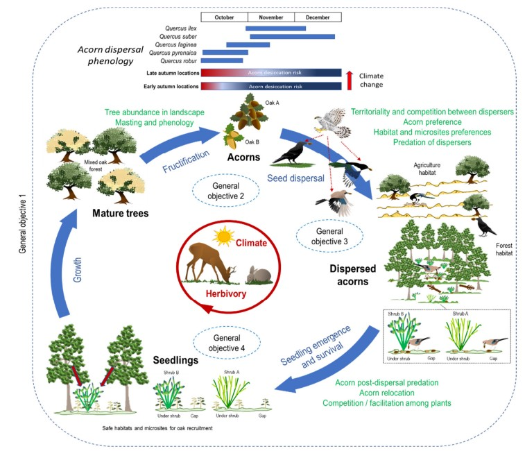
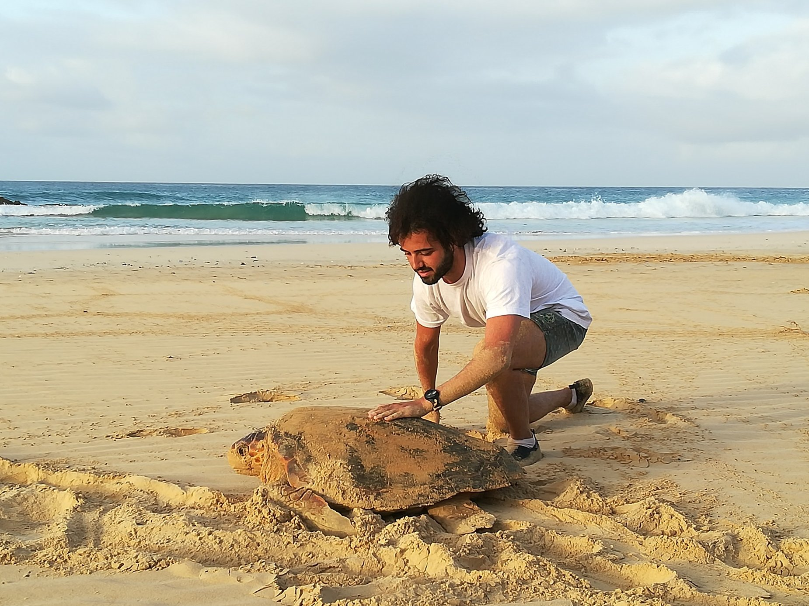

```{=html}
<div class="rf-index" aria-labelledby="rf-index-title">
  <header class="rf-intro">
    <div class="rf-container rf-intro-inner">
      <div>
        <span class="rf-kicker"><span class="rf-kicker-line" aria-hidden="true"></span> ECOLOGY &amp; CONSERVATION</span>
        <h1 id="rf-index-title">Research <span class="rf-amp">&amp;</span><br><em>Fieldwork.</em></h1>
      </div>
      <div class="rf-intro-aside">
        <span class="rf-intro-label">EXPLORE THE WORK</span>
        <p>From the roles of birds in ecosystems to woodland regeneration and hands-on wildlife conservation, discover the questions and field experiences that have shaped my work.</p>
        <span class="rf-index-count">THREE PROJECTS <span aria-hidden="true">/</span> ONE SHARED CURIOSITY</span>
      </div>
    </div>
  </header>

  <section class="rf-container rf-list" aria-labelledby="rf-list-title">
    <div class="rf-list-header">
      <h2 id="rf-list-title">Selected projects</h2>
      <span>01 — 03</span>
    </div>

    <div class="rf-grid">
      <a class="rf-card rf-card-evaluave" href="projects/EVALUAVE.html" aria-label="Explore EVALUAVE project">
        <div class="rf-card-media rf-card-media-diagram">
          
          <span class="rf-card-number">01</span>
        </div>
        <div class="rf-card-content">
          <span class="rf-card-type">RESEARCH · AVIAN ECOLOGY</span>
          <h3>EVALUAVE</h3>
          <p>Assessing the functions of birds and the ecosystem services they provide in agroforestry systems.</p>
          <span class="rf-card-action">Explore project <span class="rf-arrow" aria-hidden="true">↗</span></span>
        </div>
      </a>

      <a class="rf-card rf-card-quevadis" href="projects/QUEVAIDS.html" aria-label="Explore QueVADIS project">
        <div class="rf-card-media rf-card-media-diagram">
          
          <span class="rf-card-number">02</span>
        </div>
        <div class="rf-card-content">
          <span class="rf-card-type">RESEARCH · FOREST ECOLOGY</span>
          <h3>QueVADIS</h3>
          <p>Exploring how acorn traits, seed dispersal and facilitation influence the colonisation of coexisting oak species.</p>
          <span class="rf-card-action">Explore project <span class="rf-arrow" aria-hidden="true">↗</span></span>
        </div>
      </a>

      <a class="rf-card rf-card-bios" href="projects/BiosCV.html" aria-label="Explore BIOS Cabo Verde fieldwork photo journal">
        <div class="rf-card-media rf-card-media-photo">
          
          <span class="rf-card-number">03</span>
        </div>
        <div class="rf-card-content">
          <span class="rf-card-type">FIELDWORK · CONSERVATION · 2018</span>
          <h3>BIOS Cabo Verde</h3>
          <p>Four weeks of conservation volunteering: turtle monitoring, nest protection, hatchling measurements and data work on Boa Vista.</p>
          <span class="rf-card-action">Explore photo journal <span class="rf-arrow" aria-hidden="true">↗</span></span>
        </div>
      </a>
    </div>
  </section>

  <footer class="rf-container rf-endnote">
    <p>Curiosity in the field. Evidence for conservation.</p>
    <a href="Publications.html">Explore publications <span aria-hidden="true">↗</span></a>
  </footer>
</div>
```
