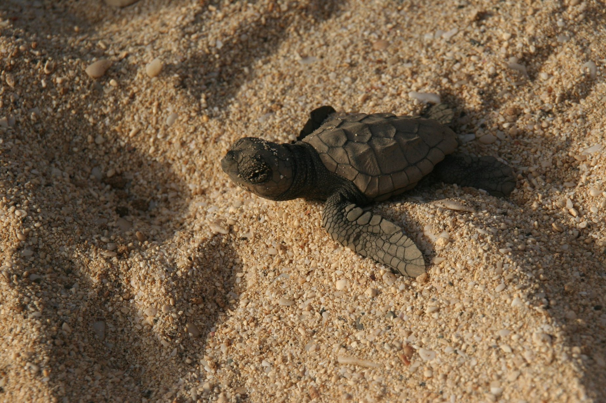
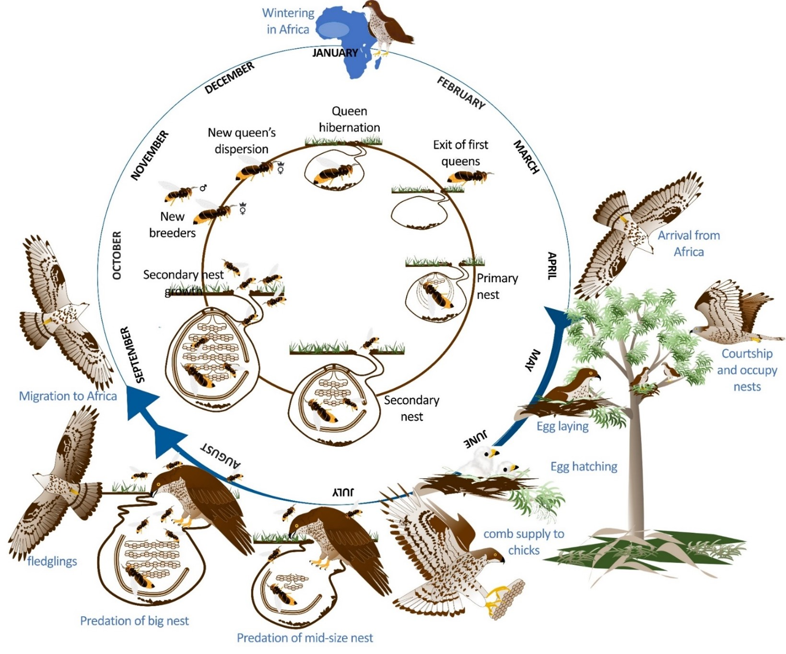
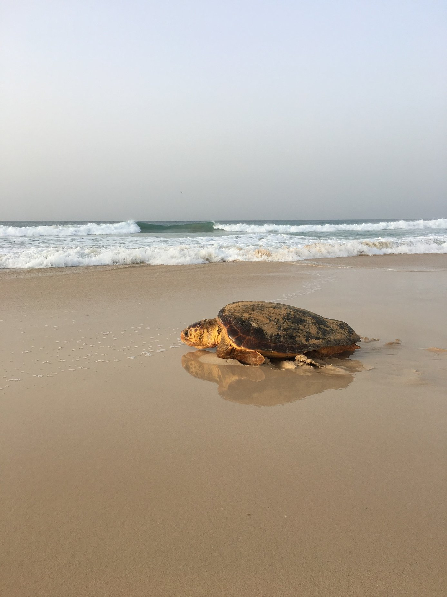
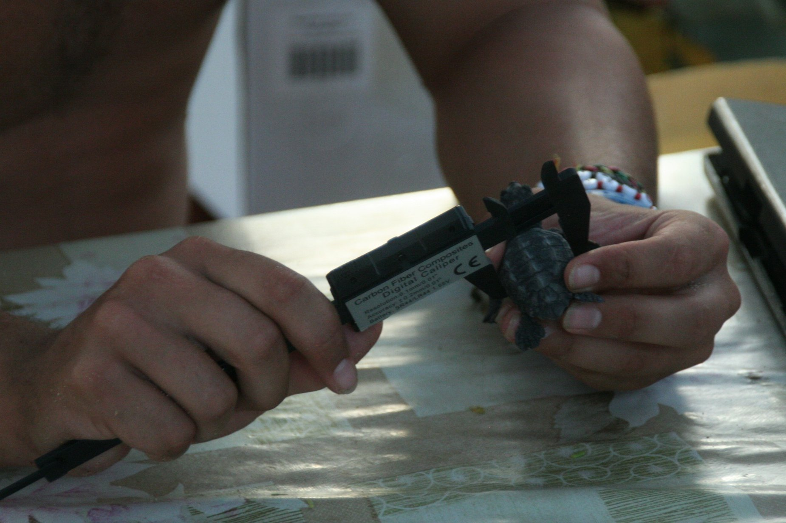

```{=html}
<section class="research-hero" aria-labelledby="research-title">
  <div class="section-width research-hero-inner">
    <div class="research-hero-copy">
      <span class="eyebrow"><span class="dot"></span> ECOLOGY · RESEARCH · CONSERVATION</span>
      <h1 id="research-title">Questions in nature.<br><em>Answers in the field.</em></h1>
      <p class="research-hero-lead">I study how species interact, how ecological processes shape landscapes, and what those relationships mean for biodiversity and the services ecosystems provide.</p>
      <p class="research-hero-sub">From bird-mediated ecosystem services and oak regeneration to hands-on sea turtle conservation, each project begins with curiosity about the natural world.</p>
      <a class="research-hero-button" href="#research-projects">Explore the work <span aria-hidden="true">↗</span></a>
    </div>
    <div class="research-hero-visual" aria-label="Photographs from fieldwork in Boa Vista">
      <figure class="research-hero-main-photo">
        
        <figcaption>BOA VISTA · CAPE VERDE · 2018</figcaption>
      </figure>
      <div class="research-hero-vertical-note" aria-hidden="true">FIELD NOTES / 01—03</div>
      <figure class="research-hero-inset">
        
      </figure>
    </div>
  </div>
</section>

<div class="research-topics" aria-label="Research themes">
  <div class="section-width research-topics-inner">
    <span>01&nbsp; Species interactions</span>
    <span>02&nbsp; Ecosystem services</span>
    <span>03&nbsp; Conservation ecology</span>
  </div>
</div>

<section id="research-projects" class="section-width research-projects" aria-labelledby="research-projects-heading">
  <div class="research-section-header">
    <div>
      <span class="eyebrow">SELECTED RESEARCH</span>
      <h2 id="research-projects-heading">Different questions.<br><em>A shared perspective.</em></h2>
    </div>
    <p>Work on the roles of birds in ecosystems and the processes that drive woodland regeneration. Explore the projects behind these questions.</p>
  </div>

  <div class="research-card-grid">
    <a class="research-project-card" href="projects/EVALUAVE.html" aria-label="Read more about EVALUAVE">
      <div class="research-project-image research-project-image-diagram">
        
        <span class="research-image-index">01 / RESEARCH</span>
      </div>
      <div class="research-project-copy">
        <span class="research-project-eyebrow">AVIAN ECOLOGY · ECOSYSTEM SERVICES</span>
        <h3>EVALUAVE</h3>
        <p>Assessing the functions of birds and the ecosystem services they provide in agroforestry systems.</p>
        <span class="research-card-cta">Explore project <span aria-hidden="true">↗</span></span>
      </div>
    </a>
    <a class="research-project-card" href="projects/QUEVAIDS.html" aria-label="Read more about QueVADIS">
      <div class="research-project-image research-project-image-diagram">
        
        <span class="research-image-index">02 / RESEARCH</span>
      </div>
      <div class="research-project-copy">
        <span class="research-project-eyebrow">FOREST ECOLOGY · SEED DISPERSAL</span>
        <h3>QueVADIS</h3>
        <p>Understanding how acorn characteristics, dispersal and facilitation influence colonisation among coexisting oak species.</p>
        <span class="research-card-cta">Explore project <span aria-hidden="true">↗</span></span>
      </div>
    </a>
  </div>
</section>

<section class="research-field-band" aria-labelledby="research-field-heading">
  <div class="section-width research-field-inner">
    <div class="research-field-images">
      <figure class="research-field-main"></figure>
      <figure class="research-field-small"></figure>
      <span class="research-field-stamp">FIELD JOURNAL<br><strong>2018</strong></span>
    </div>
    <div class="research-field-copy">
      <span class="research-field-label">CONSERVATION BEYOND THE LAB</span>
      <h2 id="research-field-heading">Four weeks on<br>the <em>turtle coast.</em></h2>
      <p>In 2018, I joined BIOS Cabo Verde as a conservation volunteer on Boa Vista. Night patrols, tagging and measuring loggerhead turtles, nest protection, hatchling monitoring and data management became part of the daily rhythm of a field camp by the sea.</p>
      <div class="research-field-facts"><span><strong>4 weeks</strong> volunteering</span><span><strong>6 km</strong> monitored beach</span></div>
      <a href="projects/BiosCV.html" class="research-field-link">Read the photo journal <span aria-hidden="true">↗</span></a>
    </div>
  </div>
</section>

<section class="section-width research-footer" aria-label="Research philosophy">
  <span class="eyebrow">WHY IT MATTERS</span>
  <p>Understanding ecological relationships is the first step towards protecting them.</p>
  <a href="Publications.html">Explore publications <span aria-hidden="true">↗</span></a>
</section>
```
