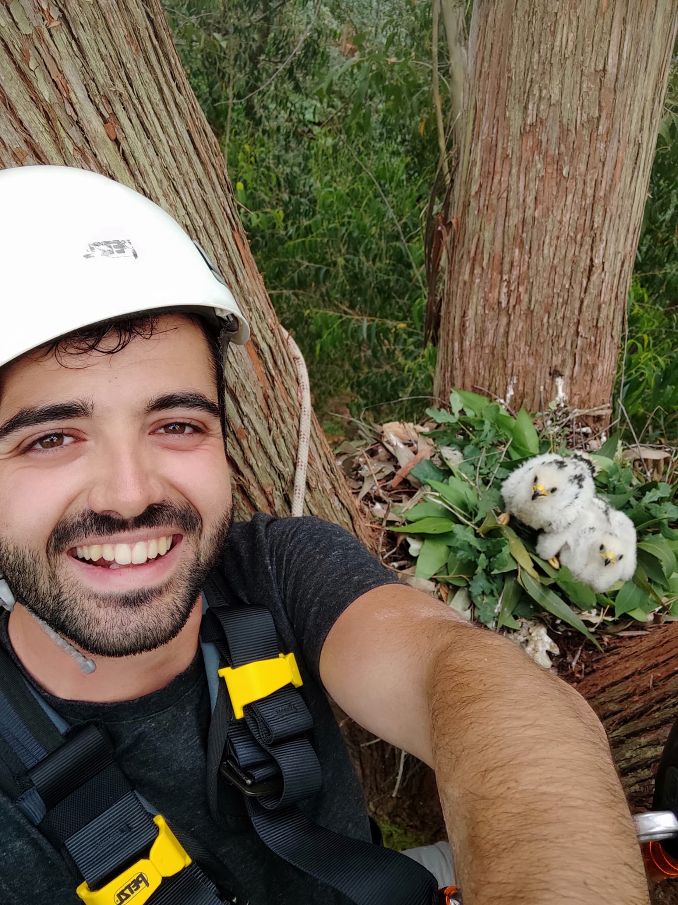

<section class="hero" aria-labelledby="hero-title">
  

    
 ECOLOGIST · PhD · SPAIN

    <h1 id="hero-title">Understanding nature. <em>Inspired by a deep love for the natural world.</em></h1>
    
I'm <strong>Jorge A. Martín-Ávila</strong>, an ecologist working at the intersection of biodiversity, species interactions and the benefits that functioning ecosystems provide to people.

    
My research combines field ecology, GPS tracking, ecological modelling and spatial analysis to understand ecological processes and inform conservation.

    

      <a class="button button-primary" href="Projects.html">Explore my research ↗</a>
      <a class="button button-outline" href="Publications.html">See publications ↗</a>
    

    

      <a href="https://orcid.org/0000-0002-1924-0130">ORCID ↗</a>
      <a href="https://scholar.google.es/citations?user=uOUlRsYAAAAJ&amp;hl=en">Google Scholar ↗</a>
      <a href="https://github.com/JAmartinavila">GitHub ↗</a>
    

  

  

    

    
    
01 / FIELDWORKFrom the field to the evidence.

  

</section>

<section class="intro-band" aria-label="Research keywords">
  Ecology &amp; biodiversityInvasive speciesSpatial ecologyEcosystem services
</section>

<section class="home-section section-width" aria-labelledby="research-title">
  

    
WHAT DRIVES MY WORK<h2 id="research-title">Research interests</h2>

    
Questions rooted in natural history, tested with quantitative tools, and connected to environmental challenges.

  

  

    <article class="research-card">01
↗
<h3>Species interactions &amp; invasive species</h3>
How native predators respond to biological invasions, and how trophic interactions influence ecosystem functioning.
</article>
    <article class="research-card">02
⌁
<h3>Landscape &amp; movement ecology</h3>
Linking animal movement and habitat use to landscape structure through GPS telemetry, field data and spatial models.
</article>
    <article class="research-card">03
◎
<h3>Ecosystem services &amp; conservation</h3>
Quantifying the ecological and societal value of biodiversity to support better-informed conservation decisions.
</article>
  

  <a class="text-link" href="Projects.html">Discover current and past projects →</a>
</section>

<section class="spotlight-band" aria-labelledby="spotlight-title">
  

    
FEATURED RESEARCH · 2026<h2 id="spotlight-title">Can a native raptor help control an invasive hornet?</h2>
Our research on the European honey-buzzard explores the ecological and economic significance of natural pest regulation. The study estimates that one breeding pair can eliminate around 67–84 invasive hornet colonies per season.
<a class="button button-light" href="https://doi.org/10.1016/j.ecoser.2026.101912">Read the study ↗</a>

    
67–84hornet colonies per pair per breeding season (model estimate)

  

</section>

<section class="home-section section-width" aria-labelledby="papers-title">
  

SELECTED OUTPUTS<h2 id="papers-title">Recent publications</h2>

Peer-reviewed research spanning biological control, landscape ecology and ecosystem-service valuation.

  

    <a class="paper" href="https://doi.org/10.1016/j.ecoser.2026.101912">2026<strong>Integrating ecology and economics: European honey buzzards as ecosystem service providers against yellow-legged hornets</strong><em>Ecosystem Services</em> · Lead author↗</a>
    <a class="paper" href="https://doi.org/10.1002/ps.8738">2025<strong>Encouraging native predators of invasive yellow-legged hornets: breeding habitat preferences of European honey buzzards in exotic Eucalyptus plantations</strong><em>Pest Management Science</em> · Lead author↗</a>
    <a class="paper" href="https://doi.org/10.1002/ps.8622">2025<strong>The European honey buzzard as an ally for the control of the invasive yellow-legged hornet</strong><em>Pest Management Science</em> · Lead author↗</a>
  

  <a class="text-link" href="Publications.html">View full publication list →</a>
</section>

<section class="contact-cta section-width" aria-labelledby="contact-title">
LET'S CONNECT<h2 id="contact-title">Interested in ecology, data or collaboration?</h2>
I'm always happy to exchange ideas about research and interdisciplinary projects.

<a class="button button-primary" href="mailto:jorgeangel.martin@uah.es">Get in touch ↗</a></section>
