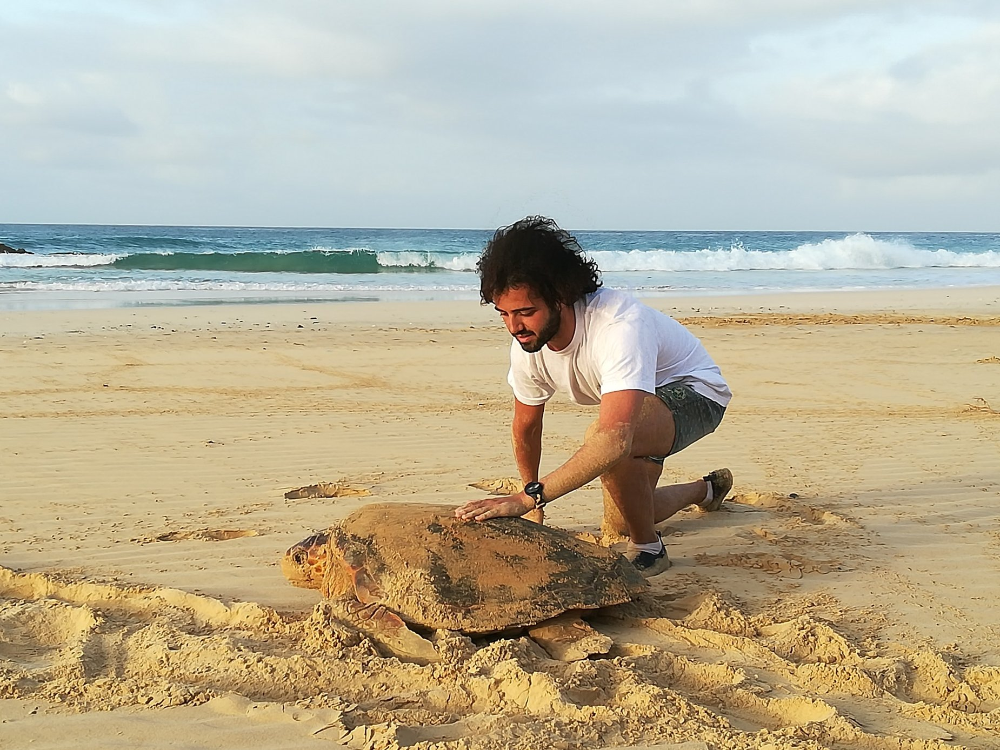
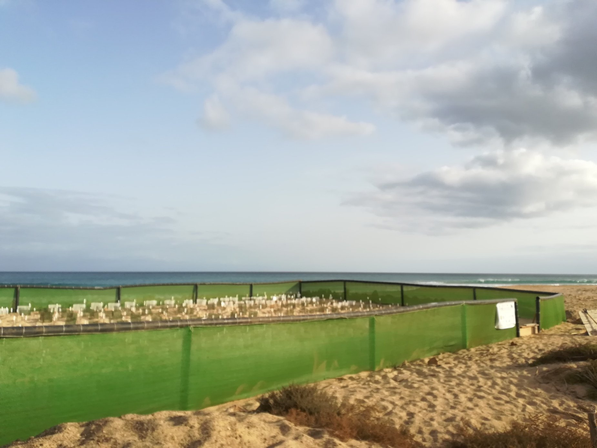
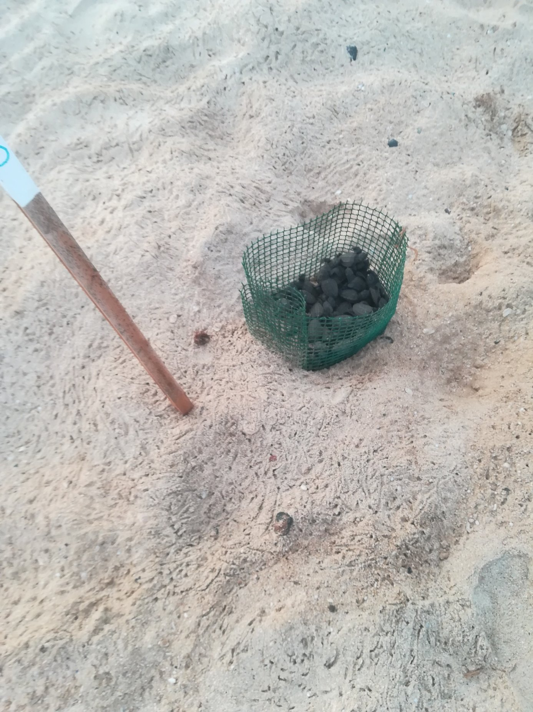
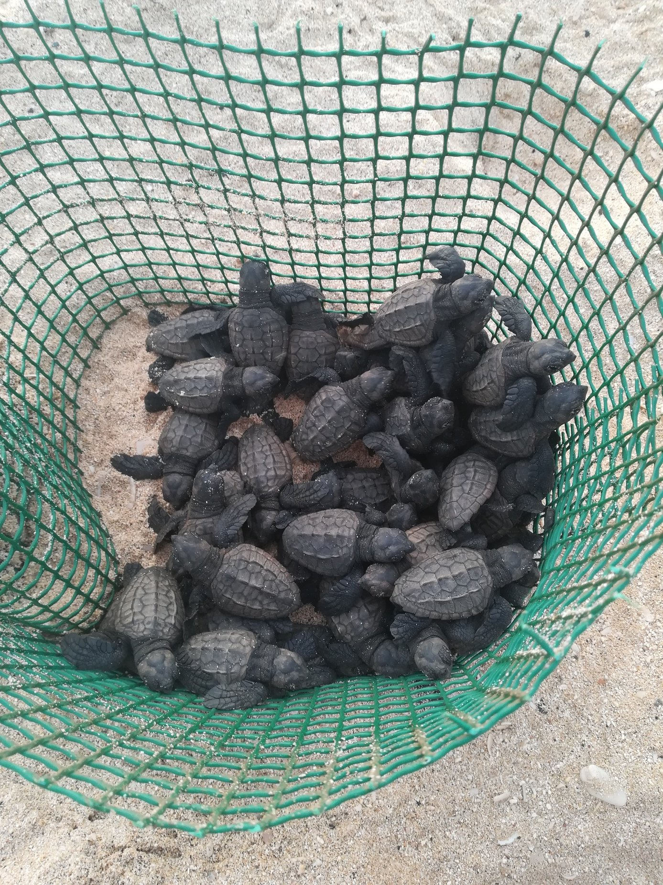
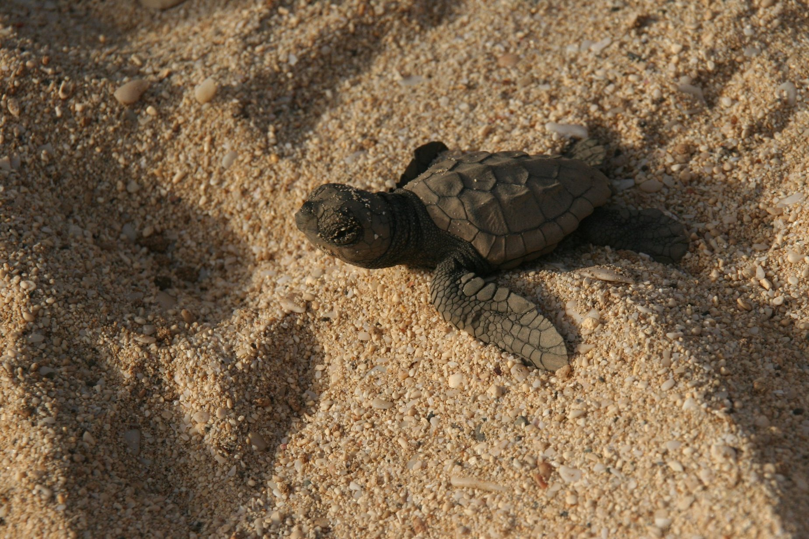
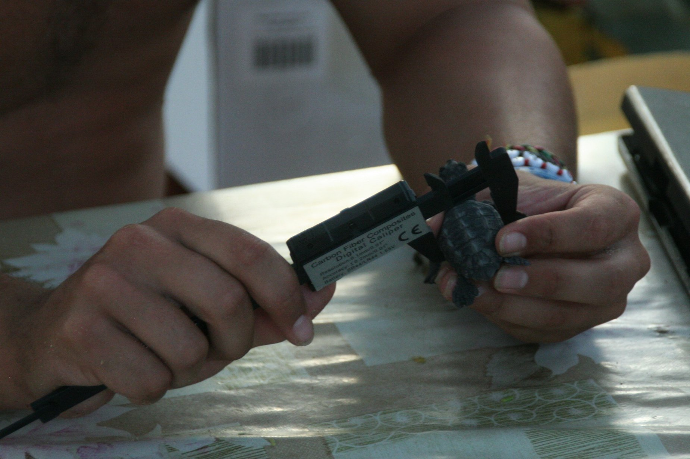
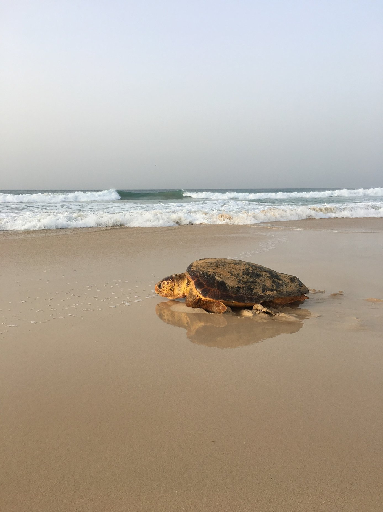
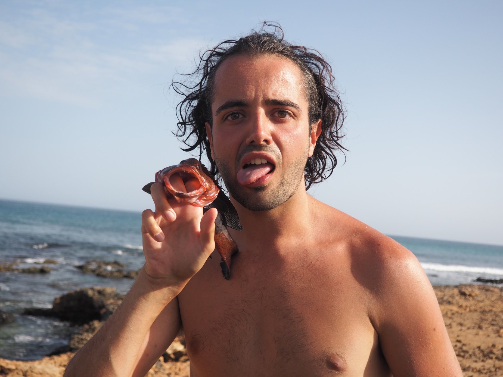

```{=html}
<section class="bios-hero" aria-labelledby="bios-heading">
  <div class="section-width bios-hero-inner">
    <div class="bios-hero-copy">
      <a class="bios-back" href="../Projects.html" aria-label="Back to Research">← Back to Research</a>
      <span class="eyebrow"><span class="dot"></span> FIELDWORK JOURNAL · 2018 · BOA VISTA</span>
      <h1 id="bios-heading">Four weeks on the <em>turtle coast.</em></h1>
      <p class="bios-hero-lead">Volunteering with BIOS Cabo Verde on the nesting beaches of Boa Vista: night patrols, sea turtle monitoring, nest protection and the daily work behind field conservation.</p>
      <div class="bios-facts" aria-label="Experience at a glance">
        <div><strong>2018</strong><span>Field season</span></div>
        <div><strong>4 weeks</strong><span>Volunteering</span></div>
        <div><strong>6 km</strong><span>Beach monitored</span></div>
        <div><strong><i>Caretta caretta</i></strong><span>Focal species</span></div>
      </div>
    </div>
    <figure class="bios-hero-photo">
      
      <figcaption>On the nesting beach, Boa Vista · Fieldwork photograph, 2018</figcaption>
    </figure>
  </div>
</section>

<section class="section-width home-section bios-intro" aria-labelledby="bios-why-heading">
  <div class="bios-section-head">
    <span class="eyebrow">WHY BOA VISTA</span>
    <h2 id="bios-why-heading">Where conservation begins on the sand</h2>
  </div>
  <div class="bios-intro-grid">
    <p class="bios-lede">Boa Vista is one of the world's most important nesting areas for the loggerhead sea turtle (<i>Caretta caretta</i>). Protecting its beaches requires sustained field monitoring and a coordinated effort by conservation staff and volunteers.</p>
    <div class="bios-side-note">
      <span class="bios-small-heading">THE ORGANISATION</span>
      <p><a href="https://bioscaboverde.com/" target="_blank" rel="noopener noreferrer">BIOS Cabo Verde</a> is a conservation organisation working on marine and coastal biodiversity through research, monitoring, education and community engagement. Its sea turtle programme includes nesting beach patrols, tagging, nest monitoring and hatchling protection.</p>
      <a class="bios-text-link" href="https://bioscaboverde.com/tartarugas/" target="_blank" rel="noopener noreferrer">Explore BIOS's sea turtle programme ↗</a>
    </div>
  </div>
</section>

<section class="bios-band" aria-labelledby="bios-camp-heading">
  <div class="section-width bios-band-inner">
    <div class="bios-band-overline">FIELD NOTES · LIFE AT CAMP</div>
    <h2 id="bios-camp-heading">A camp beneath an old acacia.</h2>
    <p>For four weeks, our home was a field camp on the southern coast of Boa Vista. An enormous old acacia stood at its centre: between its trunks and branches, we built and sheltered tents, cooking areas and shared spaces. Life was simple, communal and organised around the rhythm of the beach.</p>
    <p>Beyond the camp lay approximately six kilometres of largely untouched coastline that our team patrolled and helped protect from poaching. Once night fell, the beach became our workplace.</p>
    <div class="bios-shifts">
      <div><span class="bios-small-heading">FIRST SHIFT</span><strong>20:00–02:00</strong><small>Night patrol &amp; monitoring</small></div>
      <div><span class="bios-small-heading">SECOND SHIFT</span><strong>02:00–10:00</strong><small>Late-night &amp; morning fieldwork</small></div>
    </div>
  </div>
</section>

<section class="section-width home-section bios-work" aria-labelledby="bios-work-heading">
  <div class="section-heading">
    <div><span class="eyebrow">WHAT I DID</span><h2 id="bios-work-heading">From tracks to data.</h2></div>
    <p>These are the tasks I personally carried out as a conservation volunteer in 2018 — distinct from the broader research programme run by BIOS Cabo Verde.</p>
  </div>
  <div class="bios-work-grid">
    <article class="bios-work-card">
      <span class="bios-work-number">01 / BEACH PATROLS</span>
      <h3>Following the nesting tracks</h3>
      <p>Patrolled beaches at night to locate nesting females and nesting activity, helped protect the monitored coastline, and carried out turtle censuses by counting tracks left in the sand.</p>
    </article>
    <article class="bios-work-card">
      <span class="bios-work-number">02 / ADULT TURTLES</span>
      <h3>Marking and measuring</h3>
      <p>Assisted with the marking and morphometric measurement of nesting sea turtles and recorded field observations, including counts of eggs in clutches.</p>
    </article>
    <article class="bios-work-card">
      <span class="bios-work-number">03 / NESTS &amp; HATCHLINGS</span>
      <h3>Protecting the next generation</h3>
      <p>Located, monitored and protected nests; helped relocate clutches to a protected hatchery when needed; and collected and measured hatchlings as part of the monitoring work.</p>
    </article>
    <article class="bios-work-card">
      <span class="bios-work-number">04 / DATA &amp; OUTREACH</span>
      <h3>Beyond the night patrol</h3>
      <p>Collected scientific field data, organised and cleaned monitoring databases, and contributed to environmental education activities connected with sea turtle conservation.</p>
    </article>
  </div>
</section>

<section class="bios-story" aria-labelledby="bios-story-heading">
  <div class="section-width bios-story-grid">
    <div>
      <span class="eyebrow">A PERSONAL FIELD EXPERIENCE</span>
      <h2 id="bios-story-heading">Behind each night on the beach</h2>
    </div>
    <div>
      <p>Conservation fieldwork is built on many small, repeated tasks: walking the same stretch of sand, reading tracks, checking nests, recording measurements carefully and returning to camp to make sure the data are usable.</p>
      <p>Working alongside the BIOS team brought together direct contact with wildlife, collective responsibility for a vulnerable nesting coastline, and the less visible but essential work of organising ecological information.</p>
      <p class="bios-story-emphasis">Four weeks of hands-on conservation — from the beach to the database.</p>
    </div>
  </div>
</section>

<section class="section-width home-section bios-gallery" aria-labelledby="bios-gallery-heading">
  <div class="section-heading">
    <div><span class="eyebrow">2018 · PHOTO JOURNAL</span><h2 id="bios-gallery-heading">The field season, in pictures.</h2></div>
    <p>Eight photographs from four weeks with BIOS Cabo Verde — a closer look at the turtles, the methods and the quieter moments between shifts.</p>
  </div>

  <figure class="bios-gallery-feature">
    <a href="boa-vista-2018-hatchery.jpg" target="_blank" aria-label="Open the full hatchery photograph"></a>
    <figcaption><span class="bios-photo-kicker">01 · NEST CONSERVATION</span><strong>A safer place for vulnerable nests.</strong> Behind the green mesh of the hatchery, relocated clutches could be incubated under protected conditions. Part of our work involved transferring nests at risk, following their development and collecting information on hatchlings.</figcaption>
  </figure>

  <div class="bios-gallery-mosaic">
    <figure class="bios-photo-tile bios-photo-tile-portrait">
      <a href="boa-vista-2018-hatchlings-on-the-beach.jpg" target="_blank" aria-label="Open the hatchling monitoring photograph"></a>
      <figcaption><span class="bios-photo-kicker">02 · HATCHLINGS</span><strong>A basketful of new beginnings.</strong> Hatchlings gathered for monitoring on the sand. These close encounters were part of careful field routines that turned individual observations into conservation records.</figcaption>
    </figure>
    <figure class="bios-photo-tile bios-photo-tile-portrait">
      <a href="boa-vista-2018-hatchlings-closeup.jpg" target="_blank" aria-label="Open the close-up photograph of hatchlings"></a>
      <figcaption><span class="bios-photo-kicker">03 · CLOSE-UP</span><strong>Life on a miniature scale.</strong> A closer view of the hatchlings, each only a fraction of the size of the nesting females we encountered during patrols.</figcaption>
    </figure>
    <figure class="bios-photo-tile">
      <a href="boa-vista-2018-hatchling.jpg" target="_blank" aria-label="Open the sea turtle hatchling photograph"></a>
      <figcaption><span class="bios-photo-kicker">04 · A NEW GENERATION</span><strong>The smallest protagonists.</strong> A newly emerged loggerhead on the sand — a reminder of why protecting nesting habitat matters.</figcaption>
    </figure>
    <figure class="bios-photo-tile">
      <a href="boa-vista-2018-hatchling-measurement.jpg" target="_blank" aria-label="Open the hatchling measurement photograph"></a>
      <figcaption><span class="bios-photo-kicker">05 · FIELD METHODS</span><strong>Measurements that matter.</strong> Morphometric measurements of hatchlings were one of the practical tasks we carried out, together with careful data recording and database cleaning.</figcaption>
    </figure>
  </div>

  <div class="bios-gallery-outro">
    <figure class="bios-gallery-ocean">
      <a href="boa-vista-2018-loggerhead-ocean.jpg" target="_blank" aria-label="Open the photograph of a sea turtle near the ocean"></a>
      <figcaption><span class="bios-photo-kicker">06 · THE NESTING COAST</span><strong>Between sand and sea.</strong> An adult loggerhead against the Atlantic surf. On Boa Vista, the meeting point between ocean and beach is also a critical place for the next generation.</figcaption>
    </figure>
    <figure class="bios-gallery-candid">
      <a href="boa-vista-2018-between-shifts.jpg" target="_blank" aria-label="Open the personal photograph from Boa Vista"></a>
      <figcaption><span class="bios-photo-kicker">07 · BEYOND THE PATROLS</span><strong>Life between shifts.</strong> Not every memory was a field sheet. The people, the sea and the shared moments between patrols became part of the experience too.</figcaption>
    </figure>
  </div>
  <p class="bios-photo-credit">All photographs from my 2018 stay with BIOS Cabo Verde. The captions are personal reflections on my volunteer experience, not claims of research leadership or measured project outcomes.</p>
</section>

<section class="bios-footer-band">
  <div class="section-width bios-footer-inner">
    <div>
      <span class="eyebrow">CREDIT &amp; CONTEXT</span>
      <h2>Conservation is a team effort.</h2>
      <p>This page describes my four-week <strong>volunteer field experience in 2018</strong>, not leadership of a BIOS research project. The monitoring and conservation programme is developed by BIOS Cabo Verde and its team, with the contribution of many local and international volunteers.</p>
    </div>
    <a class="bios-primary-link" href="https://bioscaboverde.com/" target="_blank" rel="noopener noreferrer">Discover BIOS Cabo Verde ↗</a>
  </div>
</section>
```
